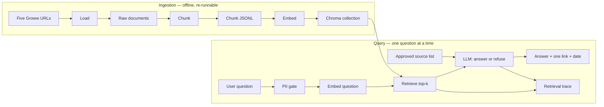
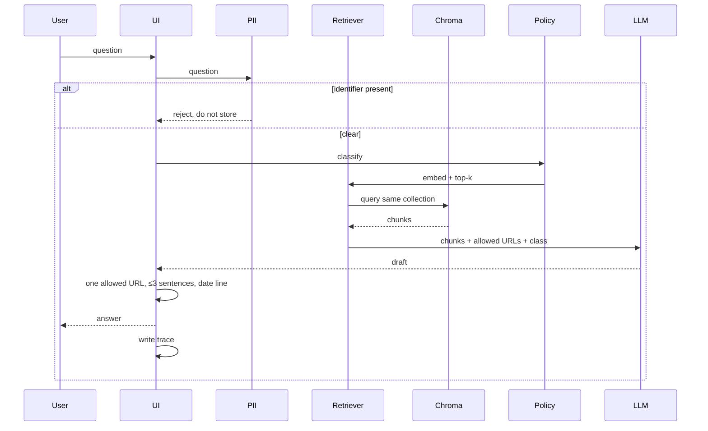

# Architecture

## HDFC Mutual Fund FAQ Assistant

**Status:** Draft  
**Source:** `Docs/PRD.md`  
**System type:** Local, phased RAG prototype. Five public pages in, one cited fact or a refusal out.

This document decides how the prototype is split, what each stage writes to disk, and how a question becomes an answer. Product rules (what to answer, what to refuse, the three-sentence cap) stay in the PRD. This file is the shape of the code and the data.

---

## 1. System in one picture

Two flows share one config file, one embedding model, and one Chroma collection.



Ingestion does not call an LLM. The query path does not fetch the web. Citations come from chunk metadata or from a hand-curated source list, never from a page the loader discovered by following links.

---

## 2. Stack

| Layer | Choice | Why |
| --- | --- | --- |
| Language | Python 3.11+ | `sentence-transformers` and Chroma’s Python client are the native path for this corpus size. |
| Config | `config.yaml` | PRD requires provider, model, embedding model, and vector-store settings to change without code edits. |
| Secrets | Environment variables | Keys never sit in config, source, or traces. |
| Embeddings | `sentence-transformers/all-MiniLM-L6-v2` | Fixed default in the PRD. Same object used to embed chunks and questions. |
| Vector store | ChromaDB, persistent, local | Demo store. Cosine space. Collection name and path come from config. |
| LLM | Provider adapter | Default Groq. Gemini, OpenAI, Anthropic, and Mistral are the other adapters. Swapping the LLM does not rebuild vectors. |
| UI | Small local web page | One screen: welcome, three examples, disclaimer, question, answer. Served only after retrieval and one refusal both work from the CLI. |
| Inspection | Files on disk | Each RAG stage is a directory a reviewer can open. The UI is not required to see the pipeline. |

No account system, no database of users, and no chat log tied to a person.

---

## 3. Layout

```text
Grow_Chatbot/
  config.yaml                 # non-secret settings
  .env                        # API keys, gitignored
  Docs/
    PRD.md
    architecture.md
    sources.md                # 15–25 official URLs (curated, not crawled)
    sample_qa.md              # 5–10 recorded answers
  src/grow_faq/
    config.py                 # load config.yaml + env
    ingest/
      load.py                 # phase 1
      chunk.py                # phase 2
      embed.py                # phase 3
      index.py                # phase 4
      run.py                  # load → chunk → embed → index
    query/
      pii.py                  # detect and drop identifiers
      retrieve.py             # embed question, query Chroma
      policy.py               # answer / refuse / factsheet redirect
      answer.py               # prompt, generate, validate
    llm/
      base.py                 # one generate() contract
      groq.py
      gemini.py
      openai.py
      anthropic.py
      mistral.py
    ui/
      app.py                  # single page
  data/
    raw/                      # one JSON per fetched page
    chunks/chunks.jsonl       # all chunks before vectors exist
    chroma/                   # Chroma persist directory
    traces/                   # one JSON per answered question, PII-free
    corpus.json               # fetch timestamp and per-URL status
```

Each phase module can be run on its own. `ingest/run.py` only sequences them. A later phase reads the previous phase’s files, not its in-memory objects, so a demo can stop between stages and point at the artifact.

---

## 4. Components

### 4.1 Config

`config.py` is the only reader of `config.yaml`. Every other module receives a settings object. Missing API keys fail at the moment a provider is constructed, with the name of the env var, not a pasted key.

Settings that live in the file:

| Key | Role |
| --- | --- |
| `corpus.urls` | Exactly the five Groww URLs from PRD §5.1. The loader refuses any other URL. |
| `embedding.model` | Default `sentence-transformers/all-MiniLM-L6-v2`. |
| `vector_db.persist_path` | Default `data/chroma`. |
| `vector_db.collection` | Default `hdfc_mf_facts`. |
| `vector_db.metric` | Default cosine. |
| `retrieval.top_k` | Default 4. |
| `llm.provider` | `groq`, `gemini`, `openai`, `anthropic`, or `mistral`. |
| `llm.model` | Provider model id. Not hard-coded in the prompt. |
| `answer.max_sentences` | Default 3. |
| `sources.catalog` | Path to `Docs/sources.md` (or a CSV of the same URLs). |

Changing `embedding.model` invalidates the collection. The index step deletes and rebuilds that collection when the stored model name differs from config. Changing `llm.provider` or `llm.model` does not.

### 4.2 Loader

Reads `corpus.urls` and fetches each page once. It does not parse `<a href>` into further requests.

For each URL it writes `data/raw/<slug>.json`:

```json
{
  "url": "https://groww.in/mutual-funds/hdfc-large-cap-fund-direct-growth",
  "scheme_or_amc": "HDFC Large Cap Fund Direct Growth",
  "fetched_at": "2026-11-26T17:00:00Z",
  "http_status": 200,
  "text": "visible page text…"
}
```

`data/corpus.json` records the run: the earliest successful `fetched_at` becomes **Last updated from sources**, plus a status per URL. A non-200 or empty body is a failed page. The run reports it and does not invent text for that URL. Chunking refuses to continue if any of the five pages failed, so the index cannot silently cover four schemes and pretend it covers five.

Text extraction keeps visible copy and labeled fact pairs. It drops scripts, nav chrome, and cookie banners. It does not keep HTML comments or embedded JSON from the Groww client as a hidden API.

### 4.3 Chunker

Input is `data/raw/*.json`. Output is `data/chunks/chunks.jsonl`, one JSON object per line.

Strategy is **section-and-field**, because these pages are fact sheets and the questions name one field.

| Page content | Chunk |
| --- | --- |
| A label plus a value (expense ratio, exit load, minimum SIP, lock-in, riskometer, benchmark) | One chunk. `field` is the normalized label. |
| A short prose block (overview, statement download) | One chunk. `field` is null. `section` is the heading. |
| A prose section longer than the embedding model’s comfortable window | Split that section only, with a small overlap. Still one scheme. |

A chunk never contains two schemes. The AMC overview page is `scheme_or_amc = "HDFC Mutual Fund"`, not mixed into a scheme chunk.

```json
{
  "id": "hdfc-large-cap-expense-ratio",
  "text": "Expense ratio of HDFC Large Cap Fund Direct Growth: 0.99%",
  "source_url": "https://groww.in/mutual-funds/hdfc-large-cap-fund-direct-growth",
  "scheme_or_amc": "HDFC Large Cap Fund Direct Growth",
  "section": "fund-details",
  "field": "expense_ratio",
  "fetched_at": "2026-11-26T17:00:00Z"
}
```

`id` is stable for a given URL + section + field + ordinal. Re-chunking the same page replaces the same ids.

Normalized `field` values the retriever and the demo care about:

`expense_ratio`, `exit_load`, `minimum_sip`, `lock_in`, `riskometer`, `benchmark`, `statement_download`, `overview`.

Anything else keeps a slug of the source label. Missing labels are not backfilled from another scheme.

### 4.4 Embedder and index

`embed.py` loads the configured sentence-transformer and embeds each chunk’s `text`. Vectors are not written as a separate giant array. Chroma stores them, and `data/chunks/chunks.jsonl` remains the human-readable stage.

`index.py` upserts into the configured collection:

| Chroma field | Source |
| --- | --- |
| `id` | chunk `id` |
| `document` | chunk `text` |
| `embedding` | vector from the configured model |
| `metadata` | `source_url`, `scheme_or_amc`, `section`, `field`, `fetched_at`, `embedding_model` |

Upsert on `id` makes a re-run replace stale facts. Metadata values are strings (Chroma’s constraint); an empty `field` is stored as `""`.

The collection’s metadata records `embedding_model`. Query-time retrieval refuses to run if that value disagrees with config, and tells the operator to re-index.

### 4.5 PII gate

Runs before retrieval and before any trace is written. Patterns cover PAN, Aadhaar, phone numbers, email addresses, OTPs (a bare numeric code in an identification context), and long account-like digit strings.

On a match:

- The raw question is not written to `data/traces/` and not sent to the LLM.
- The reply does not echo the identifier.
- The user is told the assistant does not take personal identifiers and is asked for a factual scheme question.

The gate is deterministic code, not a model judgment.

### 4.6 Retriever

Embeds the question with the same model instance family as ingestion (the name in config, loaded once per process). Queries the same collection with `top_k`.

Returns an ordered list of `{id, text, score, source_url, scheme_or_amc, section, field}`. This list is the only scheme text the LLM is allowed to see.

Optional metadata filter, applied only when the question names one of the four schemes or the AMC: restrict to that `scheme_or_amc`. “ELSS lock-in?” maps to the ELSS scheme. A question that does not name a scheme searches the whole collection.

### 4.7 Answer policy

`policy.py` classifies the question before generation. The class is a hint to the prompt and a check on the output. Retrieval still runs for factual and returns questions so the citation is real. It does not run for PII rejects.

| Class | When | What the user gets |
| --- | --- | --- |
| `answer` | A single in-scope fact (expense ratio, exit load, minimum SIP, lock-in, riskometer, benchmark, statement download). | The fact from the chunks, or a clear “not in the sources” plus the scheme page. |
| `factsheet` | Returns, performance, ranking, “which did better”. | No computed number. One link to the official factsheet in the source catalog. |
| `refuse` | Buy, sell, hold, “should I”, “which fund should I pick”, comparisons that ask for a recommendation. | Polite refusal, no recommendation, one educational URL from the catalog. |
| `pii` | Identifier detected. | Short refusal. Nothing stored. |

The LLM does not choose the citation by browsing. `answer.py` requires the single URL in the response to be either:

- the `source_url` of a retrieved chunk, or
- a URL listed in the approved catalog for that policy class (`factsheet` or `education`).

If the model emits any other URL, the response is discarded and replaced with a template that uses the top chunk’s `source_url` (for `answer`) or the catalog URL (for `refuse` and `factsheet`). The template still respects the three-sentence cap.

A post-check counts sentences and confirms the date line. The date is `corpus.json`’s last-successful-fetch timestamp, formatted as a calendar date. It is not “now” and not a NAV timestamp.

### 4.8 LLM adapter

```text
generate(system: str, user: str) -> str
```

One adapter per provider. `answer.py` depends on the interface, not on Groq. The system prompt carries the policy class, the retrieved chunks (id, field, scheme, url, text), the allowed citation URLs, the sentence cap, and the date line. It instructs the model to use only those chunks for numbers and to refuse advice even if the user rephrases it.

Provider errors surface as a short UI message that the answer could not be generated. They are not filled in from model memory.

### 4.9 Trace

After a successful non-PII turn, write `data/traces/<utc-timestamp>.json`:

```json
{
  "question": "Expense ratio of HDFC Large Cap Fund Direct Growth?",
  "policy": "answer",
  "chunk_ids": ["hdfc-large-cap-expense-ratio"],
  "scores": [0.81],
  "source_urls": ["https://groww.in/mutual-funds/hdfc-large-cap-fund-direct-growth"],
  "answer": "…",
  "citation": "https://groww.in/mutual-funds/hdfc-large-cap-fund-direct-growth",
  "llm_provider": "groq",
  "llm_model": "<from config>",
  "embedding_model": "sentence-transformers/all-MiniLM-L6-v2"
}
```

Traces exist so the demo can show retrieval separately from the sentence the user reads. They are not a user profile.

### 4.10 UI

A single local page. It does not embed, chunk, or call Groww.

| Region | Content |
| --- | --- |
| Welcome | Names the assistant and the HDFC AMC plus four direct-growth schemes. |
| Examples | Three buttons that submit factual questions from PRD §5.3. |
| Disclaimer | The facts-only snippet from PRD §6.1, always visible. |
| Input | One text field. No identity fields. |
| Response | Answer text, one link, `Last updated from sources: <date>`. |

The page calls the query path in-process (or a local HTTP handler that wraps it). It shows the same string the CLI would print.

### 4.11 Source catalog

`Docs/sources.md` is curated by hand. It holds 15–25 official URLs:

- the five ingested pages
- official factsheets for the four schemes (for the returns redirect)
- SEBI / AMFI / AMC education pages (for refusals)
- a public page that describes statement download, if that fact is not on the five Groww pages

The loader never adds to this file. Query-time citation checks read it as an allowlist.

---

## 5. Query sequence



---

## 6. What is allowed to change without a redesign

| Change | Effect |
| --- | --- |
| LLM provider or model in config | New adapter selection on the next process start. Vectors stay. |
| `top_k` | Next query uses the new breadth. |
| Embedding model | Re-run embed + index. Queries are blocked until the collection metadata matches. |
| A URL inside the five | Edit `corpus.urls` only if the PRD scope changes. Then full ingest. |
| Factsheet or education link | Edit the source catalog. No re-embed. |
| Groww HTML structure | Update the loader’s text extractor and the chunker’s label map. Raw files and chunks are regenerated. |

Adding a sixth scheme, another AMC, or in-page crawling is a product change, not a config tweak.

---

## 7. Failure behavior

| Failure | Behavior |
| --- | --- |
| One of the five fetches fails | Ingest stops before chunking. `corpus.json` lists the failure. No partial “success” index. |
| A field is absent on the page | No chunk for that field. The answer says it is not in the sources and cites the scheme page. |
| Chroma model metadata ≠ config | Query refuses and names the re-index command. |
| LLM returns a URL outside chunks and the catalog | Drop the draft. Serve the template citation. |
| LLM timeout or 401 | No fabricated fact. UI says generation failed. |
| User sends an identifier | No trace, no provider call, no echo. |

---

## 8. Build order

Matches PRD §15. The CLI is enough through step 5.

1. `config.yaml`, `.env.example`, config loader.
2. Loader → `data/raw`, `data/corpus.json`.
3. Chunker → `data/chunks/chunks.jsonl`. Confirm one scheme per chunk and the field names in §4.3.
4. Embed + Chroma upsert. Confirm idempotent re-run.
5. Retrieve, policy, answer, traces. One expense-ratio question and one “should I buy” refusal must pass here.
6. UI, disclaimer, `Docs/sources.md`, `Docs/sample_qa.md`, README.

---

## 9. Mapping to the PRD

| PRD | Where it lives |
| --- | --- |
| FR-1 five pages only | Loader allowlist = `corpus.urls` |
| FR-2 section-and-field chunks on disk | `chunk.py` → `chunks.jsonl` |
| FR-3, FR-4 same embedder and collection | `embedding.model` + collection metadata check |
| FR-5, FR-6, FR-7 answer policy | `policy.py` + citation allowlist |
| FR-8 date line | `corpus.json` `fetched_at`, not the clock |
| FR-9 UI | `ui/app.py` after step 5 |
| FR-10 no PII stored | `pii.py` before the provider and before traces |
| FR-11 stage artifacts | `data/raw`, `data/chunks`, `data/chroma`, `data/traces` |
| FR-12 config | `config.yaml` |
